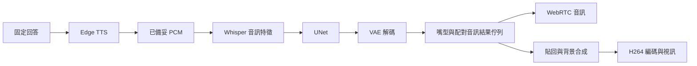

<!-- Copyright (c) 2026 HongXian0903. SPDX-License-Identifier: Apache-2.0. -->

# 固定回答與 LLM 資源競爭診斷

量測：2026-09-30；完成驗證：2026-10-01。Jetson AGX Orin 64GB、
MODE_50W，GPU 上限 816MHz；MuseTalk `musetalk_1`、FP16、batch 8、
原素材 1080×1920、25fps，Edge `zh-TW-HsiaoChenNeural`。

## 結論

數字人本身已有明確效能瓶頸。完全不載入 LLM，直接提供固定回答，
9.08 秒語音仍要 27.88 秒播完；包含即時 TTS 的首次重現甚至需
37.56 秒。LLM 不是卡頓的必要原因。

LLM 同時生成會顯著加重問題：同一份 PCM、同一數字人與播放設定，
LLM 待機為 27.54 秒，持續生成為 53.18 秒，這次約增加 93%。
GPU 平均使用率由約 85.6% 升到 96.4%，VAE、UNet 與音訊特徵
處理都變慢。記憶體最高 28,790／62,878 MB、swap 全程 0；未觀察到
OOM，沒有證據把這次卡頓歸因於 RAM 容量不足。

縮圖與 TensorRT VAE 能降低成本，但仍不足即時播放。獨立音訊排程
可使這份語音接近原長度播完，包括 LLM 持續生成時；然而嘴型同步
失敗，大量嘴型結果晚到被丟棄。它仍是隔離實驗，不能宣稱完整數字人
已修好或已通過 [ADR-0007](../../docs/adr/0007-stream-replies-with-turn-isolation-and-audio-clock.md)。

## 測試方法

固定三句文字，不呼叫 LLM 產生回答：

> 今天的測試會先確認聲音是否連續。接著比較嘴型推理造成的等待。
> 最後記錄整段語音的播放時間。

首次直接走 Edge TTS → MuseTalk → 真實 H264 WebRTC 發送與接收解碼。
另一次將相同文字的 PCM 保存為 `fixed-reply.npz`，後續每組重播完全
相同的 145,280 samples、454 個 20ms 幀、三個片段，共 9.08 秒；
因此比較不受 TTS 網路、生成文字或 ASR 差異干擾。保留原有媒體
標記與片段播放柵欄，不跳過嘴型推理或傳輸。

LLM 使用目前有效模型 `Qwen3.5-4B-UD-Q4_K_XL`，隔離 port 8092；
`-ngl 99`、context 8192、Flash Attention、Q8 KV、reasoning off。
12 執行緒為目前自動設定，另測 4 執行緒。壓力測試持續生成公開
測試題，512 tokens、`ignore_eos=true`；固定語音開始前已確認收到
第一個 LLM content。這是刻意保持運算重疊的資源競爭測試，
不代表每次一般對話都會維持這種負載。

GPU 實驗依序執行，沒有同時跑完整 pytest 或前端 build。
每組一次；初始不含 profiler 的固定文字另有一次重現。
模型載入、暖機與 WebRTC 連線不計入下面的播放時間。
這是本機 aiortc 接收解碼測試，不含 VAD、對話 ASR、瀏覽器、
實際喇叭或外部網路，不能當作使用者停口到聽見答案的 P95 驗收。

## 相同語音的結果

播放時間從第一個到最後一個 tagged PCM release，加一幀 20ms；
最大間隔也是 tagged PCM 送出間隔。語音有自然停頓，因此接收端
只計非靜音幀的間隔不直接作為停頓判定。

| 相同 9.08 秒 PCM 的條件 | 播放時間 | 最大送端間隔 | 送端連續性 |
| --- | ---: | ---: | --- |
| 原尺寸／PyTorch VAE，LLM 完全不載入 | 27.875 s | 783.52 ms | 失敗 |
| 原尺寸／PyTorch VAE，LLM 載入待機 | 27.541 s | 769.93 ms | 失敗 |
| 原尺寸／PyTorch VAE，LLM 持續生成，12 執行緒 | 53.181 s | 1683.82 ms | 失敗 |
| 同上，LLM 改 4 執行緒 | 52.078 s | 1581.88 ms | 失敗 |
| 540×960／TensorRT VAE，仍等嘴型，無 LLM | 18.552 s | 507.67 ms | 失敗 |
| 540×960／TensorRT VAE，獨立音訊，無 LLM | 9.141 s | 46.26 ms | 通過 |
| 同上，LLM 持續生成，12 執行緒 | 9.106 s | 29.56 ms | 通過 |

送端連續性門檻為全部 PCM 送出、末片段完成、最大間隔 <60ms。
所有模式的嘴型同步 gate 都失敗。獨立音訊兩組都沒有足夠的相同
片段／media_sequence A/V 配對；不能把 0 樣本解讀為零偏移。
無 LLM 的獨立音訊出現 104 次視覺輸入過載、97 次晚到嘴型丟棄；
LLM 生成時的實際數字見 [profile-fast-independent-llm.json](profile-fast-independent-llm.json)。

資料：
[無 LLM](profile-cached-no-llm.json)、
[LLM 待機](profile-llm-idle.json)、
[LLM 生成](profile-llm-generating.json)、
[4 執行緒](profile-llm-generating-t4.json)、
[加速但耦合](profile-fast-coupled.json)、
[獨立音訊](profile-fast-independent.json)。

## 瓶頸位置

原始路徑在收到 MuseTalk 結果後才送音訊。
[inference](../../src/avatars/musetalk/avatar.py) 先執行 UNet 與 VAE，
將嘴型及配對音訊放入結果佇列；
[process_frames](../../src/avatars/base.py) 從此佇列取資料後，才 enqueue PCM。
因此嘴型推理不足即時速度時，已備妥的語音也會等待。



以下為各組執行期間的呼叫中位數，包含同期競爭：

| 階段 | 不載入 LLM | LLM 待機 | LLM 生成／12 執行緒 | 加速但耦合／無 LLM |
| --- | ---: | ---: | ---: | ---: |
| UNet GPU elapsed／batch 8 | 255.65 ms | 251.04 ms | 437.68 ms | 271.50 ms |
| VAE decode host wall／batch 8 | 748.08 ms | 747.16 ms | 1665.50 ms | 376.36 ms |
| Whisper 特徵 host wall | 101.98 ms | 133.21 ms | 1879.39 ms | 116.06 ms |
| 背景合成／影格 | 44.63 ms | 43.23 ms | 39.84 ms | 15.22 ms |
| H264 encode host wall／呼叫 | 21.97 ms | 20.81 ms | 27.58 ms | 14.52 ms |

8 張影格的 25fps 時間預算為 320ms。無 LLM 時 UNet＋VAE 的中位數
已約 1004ms，僅以這兩項粗估約 8fps；加速後仍約 648ms、12fps。
這不是完整管線實測 fps，也不將不同呼叫的分位數當作同一筆樣本。
原尺寸背景合成本身約 45ms，也超過每影格 40ms 預算，且還要貼回
及編碼。縮圖能改善這部分，但不足以抵銷慢速模型。

UNet 用 CUDA events 記錄，測試結束後才同步讀值；其他為 host wall。
Whisper 特徵回傳與 VAE 解碼包含 GPU 等待／CPU 轉換，不能把上述
數值全都歸類為單一模型的純計算成本，或把重疊階段相加。
H264 使用目前 aiortc 的 `libx264` 編碼器。

## LLM 資源判定

tegrastats 每 500ms 採樣，統計只取測量窗口，因原始日誌時間精度
為一秒而保留前後一秒容差。數字包含桌面與背景服務；GPU 使用率
不是單一程序的歸因。完整摘要在 [summary.json](summary.json)。

| 條件 | GPU 平均 | GPU P95 | RAM 峰值 | Swap |
| --- | ---: | ---: | ---: | ---: |
| 無 LLM、原路徑 | 85.5% | 99% | 24,220 MB | 0 |
| LLM 待機、原路徑 | 85.6% | 99% | 28,621 MB | 0 |
| LLM 生成／12 執行緒、原路徑 | 96.4% | 99% | 28,333 MB | 0 |
| LLM 生成／4 執行緒、原路徑 | 96.3% | 99% | 28,790 MB | 0 |

LLM 單獨暖機生成約 22.52 tokens/s；與原路徑數字人並行的完整
512-token 請求約 9.30 tokens/s。4 執行緒則約 22.41／9.40 tokens/s。
雙方都變慢，符合共享 GPU 資源競爭；計算與記憶體頻寬的占比
尚未用 kernel profiler／EMC counters 分離。

4 執行緒播放時間只少約 2.1%，仍嚴重卡頓，且 GPU 平均仍約 96%。
本次不支持把減少 CPU 執行緒當作主要解法。CPU 窗口平均受背景負載
與程序等待影響，12 執行緒生成組也沒有全機 CPU 飽和的證據。
GPU 溫度峰值約 56°C；本次沒有改電源模式或時脈。

## 改善順序

1. 先降低嘴型推理成本，尤其 VAE，再處理 UNet。現有 TensorRT VAE
   將 decoder 約減半，但整體仍不足 25fps；不能只換 LLM 就期待流暢。
2. 540×960 輸出可降低背景合成與軟體編碼成本，獨立驗收人物與嘴型品質。
3. 音訊排程應避免等待嘴型；同時解決晚到嘴型的生成頻率、時鐘配對與
   有界丟幀策略。現有獨立音訊聲音通過送端門檻，嘴型尚未通過，
   不宜直接作為完整數字人的正式預設。
4. 對仍需本機 LLM 的部署，評估更低 GPU 成本的模型或將 LLM 移到
   另一運算資源。安排 LLM 與嘴型的資源預算，而非單純減少 CPU 執行緒。
   這些是後續候選方案，本次未測新模型、未變更部署。

## 重跑與範圍

```bash
# 所有條件；先合成並保存固定回答，再重播。
.venv/bin/python .scratch/fixed-reply-diagnosis/run_matrix.py

# 已有固定 PCM 時，重跑完整 GPU offload 對照。
.venv/bin/python .scratch/fixed-reply-diagnosis/run_matrix.py --llm-only

# 僅比較限制 LLM CPU 執行緒。
.venv/bin/python .scratch/fixed-reply-diagnosis/run_matrix.py --stress-only --threads 4

# 檢查完整 PCM、LLM 確有生成、VAE 未 fallback 與量測資料。
.venv/bin/python .scratch/fixed-reply-diagnosis/summarize.py
```

需已有本機 MuseTalk 素材、模型、llama-server、Edge 連線，以及先前
實驗的 `.scratch/avatar-performance/vae.engine`。工具只啟動與清理自己
持有的子程序；port 8092 已有人使用時直接停止，不終止外部服務。
後續 PCM 二進位檔與完整日誌忽略 Git；模型生成文字不寫入 JSON。

初次失敗回饋已實際執行：`fixed-no-llm.json` 的
`audio_continuity_pass` 為 false，對此欄位的 assertion 回報
`FIXED_REPLY_STUTTERS_WITHOUT_LLM`。其 9.08 秒 PCM 花 37.5629 秒播完，
最大間隔 1492.34ms。加入 profiler 的另一次固定文字為 30.5767 秒；
後續因果比較以同一份快取 PCM 為準，不把這些不同輸入時序混用。

初始 LLM 探索曾使用 `-ngl 33`；其數據保存在 `preliminary-ngl33/`，
上面的 LLM 結論全部使用與目前服務相同的 `-ngl 99` 重測。
A/V 配對工具也改以 `(fragment_sequence, media_sequence)` 為 key，
避免不同片段重複序號互相覆蓋；正式比較都已檢查此契約。

本次只新增診斷工具、數據與本報告，未改服務程式、全域設定、聲音
或模型。所有隔離數字人與 LLM 子程序均已關閉。

## 專案驗證

Focused suites：52 passed、1 skipped。整合／品牌／授權檢查通過。
完整 `uv run pytest`：471 passed、4 skipped、1 failed，44.43 秒。
唯一失敗為既有的
`test_chroma_composite_fits_the_render_frame_budget_on_a_portrait_avatar`：
要求原尺寸合成中位數 <30ms，本機量到 37.85ms。此失敗與原尺寸
合成效能瓶頸一致；本次未改其實作或放寬門檻。

`npm test`：84 passed；`npm run build`：通過。build 沿用既有 bundle
體積警告。診斷工具 `py_compile`、摘要資料契約檢查及
`git diff --check` 都通過。完整日誌在本目錄，忽略 Git。
