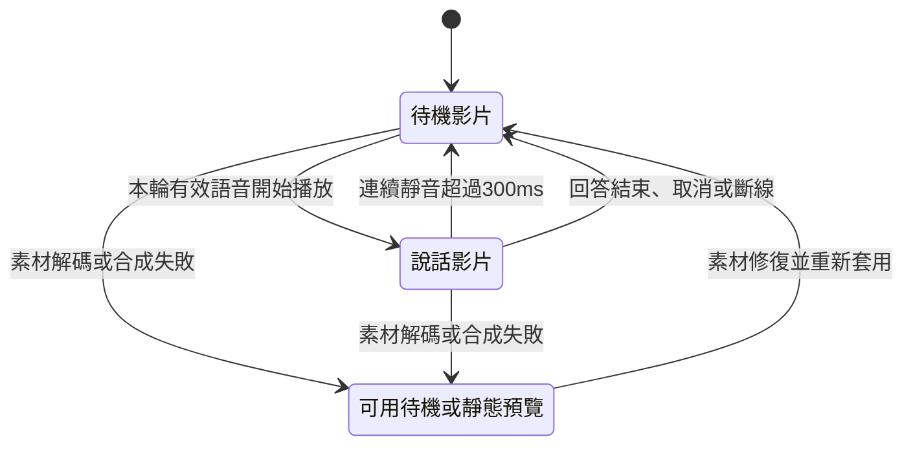

<!--
Copyright (c) 2026 HongXian0903
SPDX-License-Identifier: Apache-2.0
-->

# Jetson 數位人預錄呈現

Status: ready-for-agent

在控制台為目前數位人選擇預錄呈現或既有 MuseTalk 即時嘴型，以降低
Jetson 顯示高畫質數位人時的負擔。這份規格記錄設計訪談已確認的要求；
使用者已以「開始實做」授權實作；功能已實作，目標裝置畫面與錄影門檻已通過；
語音驗收的剩餘限制與實際效能以驗證紀錄為準。

## 已確認要求

2026-10-12 第一輪，使用者回答「根據建議」，採用以下決定：

- 預錄呈現使用可循環的嘴巴開合影片，不要求嘴型逐字對上發音。
  回答仍使用現有 LLM 與 TTS，不播放素材原有聲音作為回答。
- 跟隨回覆語音切換素材。等待模型回答時播放待機影片；回覆語音
  開始時播放說話影片，語音結束後回到待機。
- 保留可獨立更換的舞台背景，以及錄影匯出功能。
- 效能目標為 Jetson 上控制台與舞台同時開啟，呈現 1080×1920、
  25 fps，語音不中斷；具體驗收如下。以上不是已取得的測試結果。

2026-10-12 第二輪，使用者指定 Q5 並對 Q6～Q9 採用建議：

- 第一版支援上傳待機與說話兩支影片，要求相同人物、構圖與綠幕。
- 控制台新增說話素材錄製：可自行輸入文字，錄製目前數位人的五秒
  說話動作，供後續預錄呈現使用。
- 每位角色分別記住呈現方式，重新啟動後保留；既有角色預設使用
  MuseTalk，切換角色再切回時恢復該角色設定。
- 變更呈現方式前，控制台與舞台先斷線；套用後重新連線。第一版
  不加入回答途中或跨模式的無縫切換。
- 連續靜音超過 300 ms 時改播待機，下一段有效回覆語音開始時
  再播說話；取消回答或斷線時回待機。這是預錄素材的視覺規則，
  不改變收音暫停、輪次隔離與音訊主時鐘。
- 控制台與舞台保留各自對話，共用人物、背景與呈現方式。第一版
  不加入同一回答或同一素材進度的跨會話同步。

2026-10-12 第三輪，使用者回答「根據建議」，採用 Q10～Q14：

- 說話素材錄製採 MuseTalk 離線製作與完整品質解碼，不擷取即時
  演播畫面。輸出影片固定五秒，允許製作等待時間超過五秒。
- 從首段有效語音開始取五秒；文字超長只取前五秒，語音不足五秒
  則提示增加文字，不用待機畫面補滿。以 25 fps 產出 125 影格，
  不能用五秒牆鐘錄製替代固定影片時長。
- 產物保留綠幕、不帶音軌、不加入舞台背景或額外字幕；原始素材
  已含的字樣不在移除範圍。完成後可預覽、下載，使用者按「套用為
  說話影片」才替換；保留上一版以供還原，不替換待機影片。
- 預錄呈現由瀏覽器播放、去背與合成舞台背景，回覆音訊仍由
  伺服器產生。預錄模式錄影也在瀏覽器取得完成的場景畫面與
  回覆音訊；錄影頁面必須保持開啟並在前景。這是 ADR-0014
  在預錄模式下的責任調整；MuseTalk 即時模式維持既有合成責任。
- 素材未備齊時禁止啟用預錄，顯示缺件原因。已選預錄後啟動遇到
  缺件也顯示錯誤，讓使用者修復或手動選 MuseTalk，不自動載入模型。

2026-10-12 第四輪，使用者回答「根據建議」，採用 Q15～Q19：

- 製作前控制台與舞台先斷線，一次製作一支，顯示進度並支援取消；
  成功、失敗或取消後釋放製作資源，保留原有素材與呈現設定。
- 第一版接受 MP4，兩支影片須同尺寸；上傳後移除原音並統一
  25 fps。說話／待機間做約 100 ms 人物淡接，不延遲語音；
  背景不隨人物淡接。循環接縫以預覽確認，不自動修補動作。
- 更新使用中的素材也先斷線再套用，保留舊素材供還原。
- 錄影保存操作頁面那一場對話的人物、背景與回答語音，不加入
  麥克風、字幕或看板，匯出 MP4；瀏覽器不能直接錄 MP4 時，
  先保存原始錄影，再由 Jetson 非即時轉檔。
- 驗收在 Jetson 本機瀏覽器開兩個可見視窗，使用動態背景，
  連續運行並錄影至少十分鐘，包含多輪回答與插話。目標
  1080×1920／25 fps，實測平均至少 24 fps，沒有超過 200 ms
  的畫面停住，語音不缺段或異常拖長。
- 未達標時顯示實測結果，讓使用者手動降低畫質。播放失敗時
  保留可用待機或預覽畫面、繼續語音並提示，不自動切回 MuseTalk。

## 操作流程

1. 控制台「數位人與畫質」選定角色，看到「MuseTalk 即時嘴型」
   與「預錄呈現」兩種選擇，並顯示目前與待套用的設定。
2. 在同一角色的素材區上傳待機／說話影片，先驗證與準備候選
   產物，再預覽循環、去背與切換效果。只有可用的配對才能啟用預錄。
3. 如需製作說話素材，輸入朗讀文字，確認所有會話斷線後開始
   製作。完成後預覽／下載，明確套用才更新該角色說話影片。
4. 套用呈現方式或使用中素材後重新連線。控制台與舞台各自依
   該端回答語音選擇說話／待機，共用角色設定與舞台背景。
5. 開始一般對話錄影時維持該頁面在前景；停止後取得 MP4，
   需要轉檔時顯示進度，失敗時保留原始錄影供下載或重試。

說話／待機間的約 100 ms 人物淡接是視覺過渡，不等待片段播放完、
不延後語音、不修改收音與輪次狀態。取消或斷線時取消排定的視覺
事件，失效輪次不得重新觸發說話影片。

## 已查明的環境

- 目前角色選擇是全域 `model.type + model.avatar_id`；角色歸屬單一
  引擎。因此呈現方式需要與角色身分區分，才能讓同一角色保留 MuseTalk
  與預錄呈現兩種選擇。[來源](../../src/avatars/catalog.py)
- 啟動與引擎切換會載入、預熱 MuseTalk；只把前端影像換成影片無法
  避開這些成本。預錄呈現需要對應啟動、資源載入與就緒判定。
  [來源](../../src/avatars/factory.py)
- `data/avatars/musetalk_1/source.mp4` 為 1080×1920、24 fps、8 秒、
  含 AAC 音軌的原始素材。目前該素材範圍沒有明確的待機／說話雙影片
  配對，且尚未以視覺檢查認定原始素材適合作為任一種循環。
- 現有發話事件在伺服器交付首個有效 PCM 後觸發，早於瀏覽器實際
  播放；正常結束會等待回答生成、片段播放與靜音條件。句間停頓可能
  保留發話狀態；取消與斷線不能依賴最後一個 `speaking_end`。
  [來源](../../src/server/voice_session.py)
- 控制台與舞台目前分別建立會話與媒體時鐘，共用角色設定，但沒有
  共用同一輪回答。雙畫面效能驗收不等同於同一回答的同步播放要求。
  [來源](../../src/server/routes/webrtc.py)
- 現有舞台背景合成與錄影位於伺服器。預錄呈現跳過嘴型推論後，
  若保留同一影片傳輸管線，仍有解碼、縮放、去背、編碼與傳輸成本。
  [背景 ADR](../../docs/adr/0014-compose-green-screen-avatars-on-server.md)
  [錄影來源](../../src/avatars/base.py)
- 2026-10-06 既有微基準中，720×1280 縮圖、背景合成與 H264 編碼
  總耗時中位數為 58.76 ms，高於 25 fps 的 40 ms 單幀預算；該測量
  不含嘴型推論或前景 MP4 解碼。已通過的瀏覽器證據限於單一
  304×540 連線，未證實雙畫面高解析或錄影並行效能。這些歷史條件
  不能代替預錄呈現的新實測。
  [基準數據](../console-resolution/baseline-cost.json)
  [量測與範圍](../console-resolution/issues/01-resolution-and-continuity.md)
- 現有固定文字朗讀可以繞過 LLM，經 TTS 驅動目前數位人。但一般
  對話錄影保存的是縮放、合成背景與加入品牌字樣後的輸出；錄影起點
  是按鈕觸發，不是首個有效語音或嘴型影格，且沒有固定五秒影格數
  的素材製作契約。新增說話素材錄製需要獨立的素材輸出責任。
  [朗讀來源](../../src/server/voice_session.py)
  [錄影來源](../../src/avatars/base.py)
- Jetson 現有嘴型解碼設定包含近似的輕量 VAE；離線製作需明確
  選用完整品質解碼，不能把原尺寸擷取誤當作完整細節解碼。
  [設定來源](../../config/config_jetson.yaml)

## 技術約束

- 預錄模式正常啟動與對話時不載入／預熱 MuseTalk 嘴型模型，也
  不執行 MuseTalk 的嘴型與 Whisper 音訊特徵推論。STT、VAD、
  LLM、TTS 仍依對話設定運作；這不承諾完全沒有 Torch 或 GPU。
  只有使用者要求製作說話素材時才使用嘴型資源，工作結束後釋放。
- 呈現方式獨立於角色原屬引擎，不把既有 `model.type` 改寫成
  新角色。啟動、切換與 WebRTC 就緒改以實際模式能力判定，不能
  以嘴型模型物件必須非空阻止預錄模式使用。
- 回覆音訊、輪次隔離、收音與發話權威仍由伺服器擁有；接收端
  切換必須對齊收到的音訊，不能直接把較早到達的伺服器事件等同
  於使用者已聽見語音。現有事件缺少所需時間資訊，實作需要補齊
  可對齊接收音訊的媒體時序；不改用前端音量猜測發話權威。
- 控制台與舞台共用一份呈現狀態機／合成模組，會話識別與播放
  時鐘分開。媒體 envelope 保留輪次與 generation，取消、錯誤
  和斷線都有明確回待機規則，不依賴最後一個 `speaking_end`。
- 素材以串流解碼與有界快取播放，不預載整支 1080p 原始影格；
  片長、檔案大小與編碼的技術上限須沿用既有匯入限制並在控制台
  明示。人物與構圖相同由使用者透過預覽確認，尺寸由程式驗證。
- 候選素材先保存到暫存位置，驗證成功並明確套用後才原子更新
  角色素材關聯。失敗／取消不刪除角色原片、MuseTalk 素材或已用
  配對；程序重啟將未完成工作標為中斷並保留已套用版本。
- 說話素材製作不呼叫 LLM、不加入正式對話歷史，使用該角色的
  聲音設定合成嘴型驅動音訊；該音訊不混入無音軌素材。缺少來源
  或 MuseTalk 製作能力時顯示原因，不拿現有預錄循環冒充生成結果。
- 一般對話錄影不同於五秒說話素材製作；轉檔只改變容器／編碼，
  不用加速或截斷掩蓋掉幀、拖長或素材時長錯誤。錄影頁面失去
  前景時顯示提示並結束該次錄影，保留已取得的部分，不宣稱持續
  取得合格畫面。
- 瀏覽器播放與去背仍消耗觀看裝置資源，若瀏覽器也在 Jetson
  本機，成本只是重新分配，不能宣稱總負載已消失或已達標。
- 瀏覽器提供畫布擷取與媒體錄影 API，但錄影容器與編碼支援須
  在目標裝置檢查，支援判定成功也不保證資源充足。這些 API 文件
  只支持可行的介面，不是 Jetson 上 1080p／25 fps 的效能證據。
  [W3C 畫布媒體擷取工作草案](https://www.w3.org/TR/mediacapture-fromelement/)
  [MDN 錄影格式支援判定](https://developer.mozilla.org/en-US/docs/Web/API/MediaRecorder/isTypeSupported_static)

## 驗收

| 範圍 | 判定 |
| --- | --- |
| 素材匯入 | 接受同尺寸 MP4 配對；轉成 25 fps、無音軌；失敗不修改已用素材 |
| 角色設定 | 每角色記住模式；切換與重啟後恢復；既有角色預設 MuseTalk |
| 預錄啟動 | 不載入／預熱 MuseTalk；缺件提示，可手動修復或改模式 |
| 說話素材 | 125 影格、25 fps、5 秒、綠幕、無音軌；不足五秒提示加長文字 |
| 素材工作 | 斷線後單工製作；可取消；完成後釋放資源；失敗保留舊版本 |
| 素材套用 | 先預覽、可下載、明確套用；上一版可還原；待機素材不被替換 |
| 發話切換 | 依實際接收語音起止；靜音超過 300 ms 回待機；約 100 ms 人物淡接 |
| 輪次隔離 | 插話、取消、錯誤、斷線後不復播舊輪次嘴型或語音 |
| 場景 | 動態背景可更換；角色、模式與背景各自持久化；兩端各自對話 |
| 對話錄影 | 人物＋背景＋該端回答語音，MP4；字幕、看板與麥克風不混入 |
| 雙畫面性能 | Jetson 本機、兩個可見視窗、1080×1920、平均各 ≥24 fps；無 >200 ms 畫面停住 |
| 長時間負載 | 動態背景、至少十分鐘連續錄影、多輪回答與插話；兩端均量測 |
| 語音品質 | 無缺段、無渲染造成的額外停頓或異常拖長；同時比對接收語音與來源 PCM |
| 故障處理 | 顯示錯誤／實測結果；可用待機或預覽與語音保留；畫質手動調整 |
| 回歸 | 既有 MuseTalk、收音、字幕／看板、歷史提交與錄影通過相關測試 |

語音自然停頓與 TTS 等待會觸發預錄視覺切換，但不算影像拖慢語音；
驗收須記錄來源與接收端 PCM 時間跨度、額外補音、顯示影格間隔與
切換相對接收端語音的偏差，不能只用平均 FPS 或網路零丟包通過。
兩個視窗都要有獨立輪次負載，其中一端執行連續錄影；另一端至少
驗證開始／停止錄影。雙端同時錄影可另列測試，不作為本次默認負載。

## 仍需實作驗證的風險

- 首先驗證伺服器媒體時間資訊能對齊瀏覽器收到的 WebRTC 語音；
  現有事件無時間資訊，不能只收到 `speaking_start` 就切片並宣稱
  同步。驗證結果、實際偏差與可用 API 必須留下證據。
- 本機瀏覽器的雙解碼、去背、動態背景與錄影可能仍超過 Jetson
  預算。量測須記錄 Jetson 功耗模式、瀏覽器版本、素材與背景
  尺寸、解析度、其他負載；未達標就記為未達標，不放寬門檻。
- 完整 MuseTalk 解碼的可用記憶體、製作耗時、來源素材適合度與
  角色製作能力要實測；作業不得以輕量解碼靜默取代完整品質。
- 畫布去背的髮絲、綠色溢色與全身邊緣，以及 MP4 轉檔的 A/V
  連續性需要實際影片檢查。既有低解析單會話測試不能代替新驗收。

## 工作項目

以下工作項目已獲使用者授權；各票的實作與驗證進度記在 Comments。

1. [呈現方式與角色素材契約](issues/01-presentation-and-assets.md)
2. [預錄模式音訊管線與媒體時序](issues/02-audio-and-media-timing.md)
3. [瀏覽器影片合成與共用狀態機](issues/03-browser-presentation.md)
4. [五秒說話素材製作工作](issues/04-speaking-asset-production.md)
5. [瀏覽器對話錄影與 MP4 匯出](issues/05-recording-and-export.md)
6. [控制台設定與素材操作](issues/06-console-controls.md)
7. [Jetson 雙畫面與回歸驗收](issues/07-jetson-validation.md)

本輪設計文件的檢查結果與工作區基線限制見
[驗證紀錄](validation/README.md)；不能視為新功能已通過驗收。

## 文件約束

領域術語記在 [CONTEXT.md](../../CONTEXT.md)。播放、錄影與素材製作
責任記在 [ADR-0016](../../docs/adr/0016-separate-prerecorded-presentation-and-asset-production.md)，
並明確說明與 ADR-0014 的關係。訪談選項已收斂且已授權實作。
使用方式見 [預錄數位人](../../docs/prerecorded-avatars.md)。
