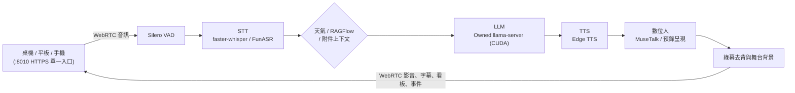

# Nova Avatar (Jetson Orin 版本)

Nova Avatar 是即時對話數位人系統。瀏覽器透過 WebRTC 傳送麥克風音訊，後端依序完成
語音端點偵測、語音轉文字、模型回答、語音合成與數位人渲染，再把影音、字幕與看板送回瀏覽器。
**Web 控制台**（`/`）負責管理設定與對話驗證，`/stage.html` 是專注互動的**數位人演播舞台**。

這個分支專為 **NVIDIA Jetson AGX Orin**（ARM64、JetPack 7／L4T R39.2.1、CUDA 13.2、
cuDNN 9、Python 3.11）移植與優化，並支援將 Orin 作為**常駐數位人助理 Server**，從同一區網或
Tailscale VPN 內的其他電腦、平板與手機開啟使用。

> 本專案由 Kedreamix/Linly-Talker-Stream 衍生，現由 HongXian0903 獨立維護。
> 上游與第三方來源見 [NOTICE](NOTICE) 和 [THIRD_PARTY_NOTICES.md](THIRD_PARTY_NOTICES.md)。

## 目錄

- [目前版本功能](#目前版本功能)
- [系統架構](#系統架構)
- [Jetson 優化與已知限制](#jetson-優化與已知限制)
- [使用的模型](#使用的模型)
- [系統需求](#系統需求)
- [從零部署到其他裝置開啟的完整流程](#從零部署到其他裝置開啟的完整流程)
- [啟動模式對照與日常維運](#啟動模式對照與日常維運)
- [其他裝置日常操作與進階能力](#其他裝置日常操作與進階能力)
- [驗證](#驗證)
- [專案結構](#專案結構)
- [文件](#文件)
- [授權與來源標註](#授權與來源標註)

## 目前版本功能

### 核心對話與語音互動
- **全鏈路即時對話**：支援**免按對話模式**、按住說話與**插話**；數位人說話期間會**收音暫停**（由伺服器推送的**發話狀態事件**控制），使用者按下麥克風即可打斷。
- **伺服器端端點與輪次編排**：Silero VAD 判定發話邊界（說完靜音 300 ms 送出），由伺服器單獨擁有**輪次編排**，取消或斷線後以**輪次隔離**丟棄舊內容。
- **回答分成口語與看板**：單一 LLM 依可編輯的**回覆規則**決定直接口述，或分流為「**口語摘要**＋**看板回覆**」條列，並以實際播放進度進行**輪次提交**。
- **回覆語音串流**：支援於控制台開啟**回覆語音串流**，邊生成邊於**完整語意邊界**切分合成語音（目前版本執行期已啟用，`strong_min_chars: 1`；**出廠預設設定**為關閉）。

### 數位人、演播場景與多語系
- **數位人呈現方式**：支援 **預錄呈現**（目前版本預設以預錄的待機與說話影片呈現動作，對話語音即時合成，回應穩定低延遲）與 **MuseTalk 即時嘴型**（FP16 TensorRT UNet + TAESD，可隨時於控制台切換）。
- **綠幕去背與演播場景**：綠幕數位人在後端即時去背合成至共用**舞台背景**（圖片、GIF、循環影片），講話中亦可切換背景。
- **舞台語系**：每場舞台對話可獨立切換「繁體中文」或「English」，同步涵蓋舞台介面、語音辨識、回覆文字與語音，不影響控制台或其他場次。
- **兩階段舞台閒置重置**：舞台回答結束閒置達設定秒數（預設 10 秒，控制台可調 3–300 秒）僅清除字幕與看板，保留記憶與附件；閒置達 120 秒後執行**場次完整清空**。

### 知識庫、附件、天氣與驗證
- **對話附件與舞台文字輸入**：可上傳 PDF 或圖片進行多輪追問，支援逐輪勾選**本輪參考附件**；舞台可開啟文字與附件輸入框，並具備截斷 JSON 修復與文字回退機制。
- **中央氣象署天氣查詢（內建工具）**：預設啟用兩階段輕量天氣閘門（一般對話 0 ms 額外延遲），支援場域預設地點與對話臨時地點即時天氣／預報查詢（需設定 `NOVA_CWA_API_KEY`）。
- **知識庫檢索（RAGFlow，選用）**：整合原生 ARM64 RAGFlow v0.27.2，依數位人選擇知識庫進行**檢索輔助回答**。
- **控制台真實語音驗證**：一鍵執行完整 LLM → TTS → 數位人 → WebRTC 鏈路，記錄各階段延遲與 Gate 結果。

### 跨裝置 Server 與單一活躍舞台保護
- **`:8010` 單一入口服務**：正式 Server 模式僅透過 `:8010`（HTTPS）直接提供已建置的控制台 `/`、舞台 `/stage.html`、API 與 WebRTC，不依賴前景 Vite 開發伺服器（`:3000`）。
- **多 SAN HTTPS 憑證與裝置信任**：支援 `mkcert` 與 OpenSSL 本地 Root CA 回退，自動簽入區網 IP、`.local` 與 Tailscale IP/MagicDNS，搭配 `rootCA.pem` 匯入指南，讓桌機與 iOS／Android 手機平板皆能正常授權麥克風與解鎖音訊播放。
- **單一活躍舞台與跨裝置接管**：Jetson 預設 `app.max_session: 1`，確保同一時間只有一台裝置透過舞台佔用即時推論資源；新裝置開啟 `/stage.html` 若已有活躍舞台，會提示「接管此舞台」而非無限重連，舊分頁收到通知後停止搶線。控制台預設停留在不佔用 GPU 的純 HTTP 管理模式。
- **會話保護與遠端介面清理**：所有會話綁定路由統一透過 `session_guard` 核對 `client_id`；遠端瀏覽器操作控制台時，會自動隱藏／提示僅限本機使用的選項（如本機 `tkinter` 選檔視窗與 `127.0.0.1:8088` 管理連結），改為路徑輸入與 SSH port-forward 指引。
- **`systemd --user` 常駐管理**：支援開機自啟（`enable-linger`）、CUDA 前置檢查、崩潰重啟、優雅關閉 **Owned llama-server** 與背景 `ollama`／RAGFlow 資源檢查。

## 系統架構



正式 Server 模式由 `aiohttp` + `aiortc` 在 `:8010` 單一入口提供全部前端靜態頁面（`web/dist`）、HTTP API 與 WebRTC；僅在開發前端 UI 時才另開 Vite（`:3000`）。完整資料流與對話輪次生命週期見 [系統架構](docs/architecture.md) 與 [ADR-0020](docs/adr/0020-single-active-stage-takeover-and-session-guard.md)。

## Jetson 優化與已知限制

下表每一項都能在 repo 內查證，括號內是出處：

| 項目 | 做法 |
| --- | --- |
| 嘴型推論 | MuseTalk UNet 建置為 FP16 TensorRT engine（[realtime-avatar.md](docs/realtime-avatar.md)） |
| 嘴型解碼 | 以 TAESD 取代原 VAE 解碼；引擎或解碼器載入失敗時回退 PyTorch UNet 與原 VAE（[realtime-avatar.md](docs/realtime-avatar.md)） |
| 輸出規格 | 直式 720×1280、25 fps、batch 8（[config_jetson.yaml](config/config_jetson.yaml)） |
| 嘴型銜接 | **嘴型連續控制**、待機相位對齊與 4–6 影格**回答收尾穩定**（[config_jetson.yaml](config/config_jetson.yaml)） |
| 語音辨識 | 以 CUDA 13.2、cuDNN 與 SM 8.7 原生編譯 CTranslate2，讓 faster-whisper 與 FunASR 在 CUDA 執行（[jetson-orin.md](docs/jetson-orin.md)） |
| 語言模型 | 以 `GGML_CUDA=ON`、SM 87 編譯 llama.cpp v0.5.0；顯存規劃以 `torch.cuda.mem_get_info()` 作為 fallback（[jetson-orin.md](docs/jetson-orin.md)） |
| CPU 爭用 | 啟動腳本與 `systemd` unit 將 OpenMP、OpenBLAS、MKL、OpenCV 執行緒限制為 1（[start-jetson.sh](scripts/start-jetson.sh)、[nova-avatar.service](integrations/systemd/nova-avatar.service)） |
| 播放緩衝 | 瀏覽器接收端音訊抖動緩衝目標 160 ms（[replyPlayout.js](web/src/replyPlayout.js)） |
| TTS 連線 | 後端啟動時預熱並重用 Edge TTS 連線池（[jetson-orin.md](docs/jetson-orin.md)） |
| 單一活躍舞台 | `max_session: 1` 搭配跨裝置佔用／接管，避免多路並發爭搶 Orin GPU（[ADR-0020](docs/adr/0020-single-active-stage-takeover-and-session-guard.md)） |
| 知識庫與天氣 | 原生 ARM64 RAGFlow v0.27.2（BGE-M3 獨立 GPU 嵌入）與單角色輕量天氣閘門（[ragflow.md](docs/ragflow.md)、[ADR-0019](docs/adr/0019-single-role-weather-tool-on-jetson.md)） |

### 目前已知限制

這個分支功能與 CUDA 路徑已驗證，但即時模式延遲仍有限制，不能沿用 RTX 4090 的效能結論（[jetson-orin.md](docs/jetson-orin.md#本機驗證結果2026-09-30)）：

- 2026-09-30 短測試中，即時 MuseTalk 兩輪語音回合首音延遲為 6.85 秒與 4.48 秒，未達 2.5 秒目標；對即時反應優先的日常助理服務，可於控制台將數位人切換為**預錄呈現**（`prerecorded`）。
- 1080×1920 綠幕背景合成的影格處理中位數 35.3 ms，超過 30 ms 門檻，門檻沒有放寬。
- TAESD 是近似解碼，牙齒與唇部細節會略柔化。
- 跨裝置連線以同區網或私人 VPN（如 Tailscale）直連為前提，未內建公網 TURN 中繼與使用者帳號登入系統。

## 使用的模型

以下為目前 Jetson Orin 版本實際執行的模型組合（由本機**執行期覆蓋設定** `config/runtime_overrides.yaml` 套用；[config_jetson.yaml](config/config_jetson.yaml) 則保留 `LFM2.5-2.6B-Q4_K_M`、`faster-whisper base` 與關閉串流的**出廠預設設定**）：

| 環節 | 目前版本使用模型／元件 | 位置與說明 | 授權依據（見 [docs/models.md](docs/models.md)） |
| --- | --- | --- | --- |
| 語言模型與視覺理解（LLM） | **Gemma-4-E2B QAT q4_0**（含多模態 `mmproj`） | `llama/gemma-4-E2B_q4_0-it.gguf` + `llama/gemma-4-E2B-it-mmproj.gguf`（由本機 CUDA `llama-server` 載入，同時負責對話、看板、天氣閘門與 PDF／圖片附件分析） | 官方模型卡標示 Apache-2.0（固定版本 `675cff42a74c774d6cb76f76d8eacb49b48c9b93`） |
| 語音轉文字（STT） | **faster-whisper `small`**（CUDA） | `models/whisper-small/`（`language: auto`，中英雙語轉繁體中文輸出） | MIT（OpenAI Whisper） |
| 語音端點偵測（VAD） | **Silero VAD**（CUDA） | `silero-vad` 套件內附 JIT 模型（靜音 `300 ms` 判定發話結束） | 套件 MIT；權重未另行稽核 |
| 語音合成（TTS） | **Edge TTS**（線上免金鑰服務，需網路） | 中文預設 `zh-TW-HsiaoChenNeural`、英文預設 `en-US-JennyNeural`（啟用連線池預熱重用） | `edge-tts` 套件 LGPLv3；線上服務與聲音條款須自行審閱 |
| 數位人呈現 | **`musetalk_1`（目前為預錄呈現）**／MuseTalk v1.5 | 預設採預錄影片呈現以確保低延遲穩定；切換即時嘴型時使用 `models/musetalk/`、FP16 TensorRT UNet 與 TAESD（720×1280） | MuseTalk 程式碼 MIT（TME）；TAESD MIT；權重條款未逐項稽核 |

本機 `llama/` 與 `models/` 另備有可從控制台切換的模型：Whisper `large-v3-turbo`／`base`、FunASR `paraformer-zh`、`LFM2.5-2.6B-Q4_K_M`、`LFM2.5-1.2B-Instruct`、`Granite-4.2-3B`、`Ministral-3-3B`、`Qwen3.5-4B／2B` 等。**完整清單、檔案位置與授權依據見 [使用的模型](docs/models.md)。**
Wav2Lip 為 **Research / Non-commercial**，不得視為具商業許可，本分支也未驗證其 ARM64 相依套件。

## 系統需求

- **硬體**：NVIDIA Jetson AGX Orin 64GB／32GB（或相容的 Orin 模組）。
- **作業系統**：Ubuntu 24.04 LTS（aarch64）、JetPack 7 / L4T R39.2.1。這不是 JetPack 6 的流程，不要在舊版 JetPack 上直接套用 CUDA 13 套件。
- **CUDA**：CUDA Toolkit 13.2（`/usr/local/cuda`）、cuDNN 9。
- **Python 與前端工具**：Python 3.11（[uv](https://docs.astral.sh/uv/) 管理）、Node.js 22 與 npm。
- **系統套件**：

  ```bash
  sudo apt-get update
  sudo apt-get install -y ffmpeg ninja-build cmake build-essential libopenblas-dev pkg-config lsof openssl
  ```

- **網路與憑證**：Edge TTS 需要網路；若需跨裝置使用，建議安裝 `mkcert`（未安裝時腳本會自動改用 `openssl` 產生本地 Root CA）或透過 Tailscale 建立跨區網加密連線。

## 從零部署到其他裝置開啟的完整流程

依序完成 **步驟 1–7**，即可將 Jetson Orin 部署為常駐助理 Server 並從電腦、平板或手機開啟使用（已經完成環境建置與模型準備的主機可直接從 **步驟 4** 開始）：

### 步驟 1：取得程式並建置 Jetson 環境與前端

```bash
git clone --branch jetson-orin https://github.com/s0966066980/nova-avatar.git
cd nova-avatar
bash scripts/setup-jetson.sh
```

亦可執行 `bash scripts/setup-env.sh musetalk`，腳本偵測到 Jetson 後會自動轉交 `setup-jetson.sh`，依序完成 ARM64 CUDA 13.2 原生 CTranslate2 編譯、Python 3.11 `.venv` 與 PyTorch 2.11 cu130 安裝、cuSPARSELt metadata 修正、依賴同步、前端 `web/dist` 建置及 `scripts/check-cuda.py` 自我檢查。

### 步驟 2：編譯 llama.cpp

```bash
bash scripts/build-jetson-llama.sh
```

以 `GGML_CUDA=ON` 與 SM 87 編譯 llama.cpp v0.5.0（置於 `.local/jetson/llama.cpp/`）。可用 `NOVA_BUILD_JOBS=4` 降低並行度；加上 `--download-model` 可下載預設 Qwen 模型並驗證 SHA-256。

### 步驟 3：準備模型、素材與選用金鑰

模型權重、TensorRT engine 與角色素材不加入 Git，全新 checkout 需依目前版本需求準備：

| 項目 | 位置 | 準備方式 |
| --- | --- | --- |
| LLM 與視覺投影（目前預設 Gemma-4-E2B） | `llama/` | 下載 `gemma-4-E2B_q4_0-it.gguf` 與 `gemma-4-E2B-it-mmproj.gguf`（見下方指令；可另放 `LFM2.5-2.6B-Q4_K_M.gguf` 等備選） |
| 語音辨識（目前預設 `whisper-small`） | `models/whisper-small/` | 準備 CTranslate2 格式 Whisper `small`（`base` 可於首次執行自動下載） |
| 角色素材（含預錄呈現） | `data/avatars/musetalk_1/` | 預設角色（含 `prerecorded/` 待機與說話影片素材） |
| MuseTalk 與即時嘴型權重（即時模式用） | `models/musetalk/`、`models/sd-vae/`、`models/face-parse-bisent/` | `bash scripts/download_musetalk_weights.sh` |
| TAESD 與 TensorRT UNet engine（即時模式用） | `.local/jetson/taesd/`、`.local/jetson/musetalk-unet-fp16.engine` | 下載 TAESD（見下方指令），並依 [realtime-avatar.md](docs/realtime-avatar.md#本機檔案) 建置 engine |
| CWA 天氣 API 金鑰（選用） | `config/cwa.env` | 寫入 `NOVA_CWA_API_KEY=<你的氣象署授權碼>`（`0600` 權限，不入 Git） |

```bash
# 1. 下載目前預設之 Gemma-4-E2B QAT q4_0 GGUF 與多模態 mmproj（固定版本）
uvx --from huggingface_hub hf download google/gemma-4-E2B-it-qat-q4_0-gguf \
  gemma-4-E2B_q4_0-it.gguf gemma-4-E2B-it-mmproj.gguf \
  --revision 675cff42a74c774d6cb76f76d8eacb49b48c9b93 \
  --local-dir llama

# 2. 若需即時 MuseTalk 嘴型，下載 TAESD 輕量解碼器
uvx --from huggingface_hub hf download madebyollin/taesd \
  config.json diffusion_pytorch_model.safetensors README.md \
  --revision 614f76814bbe30edbe2e627ace1c2234c81a2c0e \
  --local-dir .local/jetson/taesd
```

### 步驟 4：產生多 SAN HTTPS 憑證

瀏覽器在非 `localhost` 來源開啟麥克風與 WebRTC 音訊必須使用受信任的 HTTPS，且憑證必須簽入 Orin 的區網 IP／主機名稱：

```bash
bash scripts/create_ssl_certs.sh
# 若需額外指定網域或 Tailscale Host，可加上 --host：
# bash scripts/create_ssl_certs.sh --host orin.tailnet.ts.net
```

- 腳本優先使用 `mkcert`，若未安裝會自動改用 `openssl` 建立本地 Root CA（`ssl_certs/rootCA.pem` / `rootCA.crt`），並將 `localhost`、`127.0.0.1`、Orin 區網 IP、`<hostname>.local` 與 Tailscale IP/DNS 簽入 `ssl_certs/localhost.crt`（私鑰為 `ssl_certs/localhost.key`）。
- 檢查實際簽入的位址與查詢目前 Orin IP：

  ```bash
  hostname -I
  openssl x509 -in ssl_certs/localhost.crt -noout -ext subjectAltName
  ```

### 步驟 5：檢查資源並啟動 Jetson 常駐 Server（`:8010` 單一入口）

1. 執行前置檢查（確認設定、憑證、`web/dist`、`linger` 與背景 `ollama` 佔用）：

   ```bash
   bash scripts/jetson-service.sh check
   ```

   > 若 Phase 1 不使用 RAGFlow 知識庫且畫面提示系統級 `ollama` 正在背景執行，可執行 `bash scripts/jetson-service.sh stop-ollama`（或自行停用 `ollama`）以釋放統一記憶體。

2. 安裝並啟動 `systemd --user` 常駐服務（預設 `NOVA_START_RAGFLOW=0`，支援崩潰自動重啟與優雅停止 **Owned llama-server**）：

   ```bash
   bash scripts/jetson-service.sh install --start --linger
   ```

   *(系統需要約 **15–30 秒** 完成 `scripts/check-cuda.py` 與模型／Edge TTS 預熱；請稍候再執行健康檢查確認就緒。)*

   ```bash
   bash scripts/jetson-service.sh health
   # 看到 {"code": 0, "ready": true, "model_ready": true, ...} 即代表就緒
   ```

### 步驟 6：在另一台裝置匯入 Root CA 憑證信任

將 Orin 上的 **`ssl_certs/rootCA.crt`**（或 `rootCA.pem`）傳到目標裝置並匯入信任（**切勿傳送 `*.key` 或 `rootCA-key.pem`**；詳細步驟見 [跨裝置 HTTPS 憑證信任指南](docs/https-device-trust.md)）：

- **Windows**：雙擊 `rootCA.crt` →「安裝憑證」→「本機電腦」→ 放入「**受信任的根憑證授權單位**」→ 重開瀏覽器。
- **macOS**：雙擊 `rootCA.crt` 加入鑰匙圈 → 雙擊該 CA →「信任」設為「**永遠信任**」。
- **iPhone / iPad（兩步驟皆須完成）**：
  1. 下載描述檔後至「設定 → 一般 → VPN 與裝置管理」完成**安裝**。
  2. 再至「設定 → 一般 → 關於本機 → 憑證信任設定」開啟**完全信任**。
- **Android**：至「設定 → 安全性 → 更多安全設定 → 從儲存空間安裝 → CA 憑證」選取 `rootCA.crt`。

### 步驟 7：在另一台裝置瀏覽器開啟並使用

確認該裝置與 Orin 處於**同一區網（Wi-Fi／LAN）或同一 Tailscale 網路**，將 `<orin-host>` 換成步驟 4 查到的 Orin IP（例如 `192.168.1.50`）或 Tailscale 位址：

- **開啟數位人舞台（主要互動裝置）**：`https://<orin-host>:8010/stage.html`
  - 首次進入請允許瀏覽器**麥克風權限**；在手機／平板若出現聲音解鎖按鈕，點一下即可啟用音訊播放。
  - 若另一台裝置先前已開著舞台，新裝置會顯示「目前已有其他裝置正在使用舞台」，點「**接管此舞台**」即可接手並停止舊裝置搶線。
- **開啟 Web 控制台（遠端管理／驗證，可選）**：`https://<orin-host>:8010/`
  - 可從另一台電腦遠端調整 LLM／語音／數位人／舞台背景／天氣設定，或在「語音驗證」面板測試完整鏈路。

---

## 啟動模式對照與日常維運

依使用情境選擇執行模式，**不要同時啟動 `nova-avatar.service` 與 `start-jetson.sh`（兩者會搶佔 `:8010` 埠）**：

### 常駐服務常用維運指令（方式 A：`:8010` 單一入口）

```bash
bash scripts/jetson-service.sh status    # 檢視服務狀態、健康端點與外部 ollama 提醒
bash scripts/jetson-service.sh health    # 驗證 https://127.0.0.1:8010/health 回傳 ready: true
bash scripts/jetson-service.sh logs      # 即時追蹤 journald 日誌
bash scripts/jetson-service.sh restart   # 更改設定、憑證或重建 web/dist 後重啟（需等 ~15–30 秒載入）
bash scripts/jetson-service.sh stop      # 停止服務（要切換至前景開發模式前請先執行）
```

若不想安裝 `systemd` 而只想在前景手動跑 `:8010` 單一入口：

```bash
bash scripts/start-server.sh config/config_jetson.yaml
# 若修改過 web/ 原始碼，可加 --build 自動重建 web/dist：
# bash scripts/start-server.sh --build config/config_jetson.yaml
```

### 前景開發／除錯與診斷模式（方式 B）

> 若先前已啟動 `nova-avatar.service`，請先執行 `bash scripts/jetson-service.sh stop` 再執行以下指令。

| 指令 | 設定檔 | 用途 |
| --- | --- | --- |
| `bash scripts/start-jetson.sh` | `config/config_jetson.yaml` | **開發期雙埠模式**：同時啟動 `:8010` 後端與 `:3000` Vite HMR（已準備 RAGFlow 時自動帶起；設 `NOVA_START_RAGFLOW=0` 可略過） |
| `bash scripts/start-jetson.sh --prod` | `config/config_jetson.yaml` | 通過 CUDA 檢查後轉交 `scripts/start-server.sh` 以 `:8010` 單一入口執行 |
| `bash scripts/start-jetson.sh --read-aloud` | `config/config_jetson_read_aloud.yaml` | 固定文字朗讀驗證，不載入 LLM／VAD／ASR |
| `bash scripts/start-jetson.sh --realtime` | `config/config_jetson_realtime.yaml` | 單一會話音畫同步與低延遲診斷，不載入 LLM／VAD／ASR |

### 服務入口對照

| 入口 | 單一入口（Server / `--prod`） | 開發期雙埠（`start-jetson.sh`） | 用途 |
| --- | --- | --- | --- |
| 數位人舞台 | `https://<orin-host>:8010/stage.html` | `https://<orin-host>:3000/stage.html` | 訪客／主要互動視窗（語音、文字、附件、背景合成） |
| Web 控制台 | `https://<orin-host>:8010/` | `https://<orin-host>:3000/` | 遠端管理設定、Prompt、模型、語音驗證與紀錄 |
| 健康檢查 | `https://<orin-host>:8010/health` | `https://<orin-host>:8010/health` | 回傳 HTTP 200 且 `ready: true` 表示就緒 |
| RAGFlow 管理 | `http://127.0.0.1:8088`（限本機） | `http://127.0.0.1:8088`（限本機） | 遠端管理請使用 SSH port-forward（`ssh -L 8088:127.0.0.1:8088 <user>@<orin-host>`） |

### 常見問題排查

- **`restart` 後馬上跑 `health` 顯示無法連線**：`ExecStartPre` 需先執行 `check-cuda.py` 且主程式需載入模型與預熱 Edge TTS（約 15–30 秒），稍候再執行 `bash scripts/jetson-service.sh health` 或看 `bash scripts/jetson-service.sh status`。
- **Orin 換了 Wi-Fi IP 或新裝 Tailscale**：重跑 `bash scripts/create_ssl_certs.sh`（沿用既有 `rootCA.pem`，裝置端免重裝 CA）後執行 `bash scripts/jetson-service.sh restart`。
- **另一台裝置無法開麥克風或跳安全警告**：確認已匯入 `ssl_certs/rootCA.crt` 並完成信任（iOS 須完成「描述檔安裝」與「憑證信任設定」兩步），且網址使用的是有簽進憑證 SAN 的 IP 或主機名稱。
- **改過前端程式但 `:8010` 畫面沒變**：單一入口服務提供的是靜態 `web/dist`，請執行 `cd web && npm run build` 後重啟服務。

## 其他裝置日常操作與進階能力

### 1. 在其他裝置開啟舞台（`/stage.html`）
1. 確保已匯入並信任 Orin 的 `rootCA` 憑證。
2. 開啟 `https://<orin-host>:8010/stage.html` 並允許麥克風權限；在手機／平板上若瀏覽器暫停自動播放，點選畫面顯示的音效解鎖按鈕即可啟用聲音。
3. **跨裝置舞台接管**：若另一台裝置原本已開著舞台，新裝置會提示「目前已有其他裝置正在使用舞台」，點擊「**接管此舞台**」即可接手並中斷舊裝置連線。
4. **對話互動**：支援**免按對話模式**（靜音 300 ms 自動送出）、按住說話與**插話**；右下／下方可依設定使用文字與圖片／PDF 對話附件輸入，並可即時切換中文／English **舞台語系**。

### 2. 在其他裝置開啟控制台（`/`）
- 控制台預設停留在管理模式（不建立佔用 GPU 的 WebRTC 連線），可直接調整 LLM／STT／TTS／舞台設定、編輯回覆規則與助手身分、管理背景與角色，或檢視天氣／知識庫設定。
- 若需在遠端調整伺服器本機模型路徑，系統會自動隱藏僅限本機的系統選檔按鈕並切換為文字路徑輸入（STT 支援切換「自訂路徑」輸入）。
- 需要測試完整語音鏈路時，再點擊連線並於「語音驗證」面板執行一鍵測試。

### 3. 選用知識庫檢索（RAGFlow）

```bash
bash scripts/ragflow.sh build       # 建置原生 ARM64 映像（固定 v0.27.2）
bash scripts/ragflow.sh up          # 啟動 RAGFlow 與主機 GPU 嵌入程序（BGE-M3）
bash scripts/ragflow.sh pull-model  # 下載嵌入模型並預熱
bash scripts/ragflow.sh connect     # 自動連線並寫入 config/ragflow.env（0600，不入 Git）
bash scripts/ragflow.sh status      # 檢視狀態
```

啟用後於控制台「設定 → 知識庫檢索」確認「RAGFlow 已連線」並勾選知識庫即可。若要在常駐 `systemd` 服務中一併自動啟動 RAGFlow，請於環境覆蓋設定 `NOVA_START_RAGFLOW=1`（詳見 [jetson-orin.md](docs/jetson-orin.md) 與 [ragflow.md](docs/ragflow.md)）。

### 進階文件索引

| 功能 | 文件 |
| --- | --- |
| 跨裝置 HTTPS 憑證與信任教學 | [https-device-trust.md](docs/https-device-trust.md) |
| 助手角色、Prompt 與回覆規則 | [llm-reply-rules.md](docs/llm-reply-rules.md) |
| 對話附件與舞台文字輸入 | [conversation-attachments.md](docs/conversation-attachments.md) |
| 預錄數位人與說話素材製作 | [prerecorded-avatars.md](docs/prerecorded-avatars.md) |
| RAGFlow 知識庫檢索 | [ragflow.md](docs/ragflow.md) |
| 固定文字朗讀 | [fixed-read-aloud.md](docs/fixed-read-aloud.md) |

## 驗證

提交與發布前依序執行：

```bash
uv run python scripts/check-cuda.py --models   # 真實 CUDA 模型推論（MuseTalk、faster-whisper、FunASR、Silero）
uv run python scripts/check-integration.py     # 品牌、授權與整合稽核
uv run pytest                                  # Python 測試
cd web
npm test                                       # 前端測試
npm run build                                  # 前端 production build（更新 :8010 服務之 web/dist）
```

不要只用 `torch.cuda.is_available()` 判斷模型可用。已記錄的驗證結果與限制見
[jetson-orin.md](docs/jetson-orin.md#本機驗證結果2026-09-30)。

## 專案結構

| 路徑 | 說明 |
| --- | --- |
| `src/` | 後端：`server/`、`vad/`、`asr/`、`llm/`、`tts/`、`avatars/`、`scene/`、`ragflow/`、`weather/`、`config/` |
| `web/` | Vue 3 控制台、`stage.html` 舞台與建置輸出 `dist/` |
| `config/` | `config_jetson*.yaml` 出廠預設設定（執行期覆蓋與金鑰 `.env` 不入 Git） |
| `scripts/` | 建置、憑證（`create_ssl_certs.sh`）、單一入口（`start-server.sh`）、`systemd` 管理（`jetson-service.sh`）、驗證與 RAGFlow 腳本 |
| `integrations/` | 整合設定檔：`systemd/nova-avatar.service`、RAGFlow Compose 與服務模板 |
| `models/`、`llama/` | 模型權重與 GGUF（不入 Git） |
| `data/avatars/` | 數位人角色素材 |
| `docs/` | 文件與 ADR，入口見 [docs/README.md](docs/README.md) |
| `tests/` | Python 測試 |
| `third_party/` | 第三方程式碼與授權檔 |

## 文件

完整索引見 [docs/README.md](docs/README.md)。

- [系統架構](docs/architecture.md)
- [使用的模型](docs/models.md)
- [Orin 建置與 CUDA 驗證](docs/jetson-orin.md)
- [跨裝置 HTTPS 憑證信任指南](docs/https-device-trust.md)
- [數位人即時生成與 TensorRT UNet 診斷](docs/realtime-avatar.md)
- [專案詞彙表](CONTEXT.md)
- [架構決策紀錄（ADR）](docs/adr/)

## 授權與來源標註

- **Nova Avatar** 獨立撰寫的程式碼採 [Apache-2.0](LICENSE) 授權。
- **MuseTalk** 程式碼採 MIT 授權（Copyright Tencent Music Entertainment Group）；其模型權重及相依套件另受各自條款約束。
- 專案內整合的 **Wav2Lip** 僅供 **Research / Non-commercial**（學術與個人非商業用途），不得視為具商業許可。
- RAGFlow、BGE-M3、中央氣象署 API、外部語音合成與各語言模型權重都有獨立授權；根目錄授權不涵蓋它們的權重與外部服務。
- 詳見 [NOTICE](NOTICE)、[THIRD_PARTY_NOTICES.md](THIRD_PARTY_NOTICES.md) 與 [來源標註稽核](docs/source-attribution-audit.md)。
