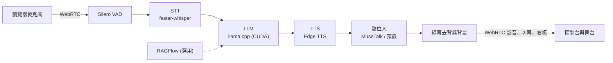

# Nova Avatar (Jetson Orin 版本)

Nova Avatar 是即時對話數位人系統。瀏覽器透過 WebRTC 傳送麥克風音訊，後端依序完成
語音端點偵測、語音轉文字、模型回答、語音合成與數位人渲染，再把影音和字幕送回瀏覽器。
**Web 控制台**用來對話與調整設定，`/stage.html` 是獨立的**數位人演播舞台**。

這個分支專為 **NVIDIA Jetson AGX Orin**（ARM64、JetPack 7／L4T R39.2.1、CUDA 13.2、
cuDNN 9、Python 3.11）移植與優化，所有安裝、啟動與文件都以 Orin 為準。

> 本專案由 Kedreamix/Linly-Talker-Stream 衍生，現由 HongXian0903 獨立維護。
> 上游與第三方來源見 [NOTICE](NOTICE) 和 [THIRD_PARTY_NOTICES.md](THIRD_PARTY_NOTICES.md)。

## 目錄

- [功能](#功能)
- [系統架構](#系統架構)
- [Jetson 優化](#jetson-優化)
- [使用的模型](#使用的模型)
- [系統需求](#系統需求)
- [安裝步驟](#安裝步驟)
- [啟動與使用](#啟動與使用)
- [驗證](#驗證)
- [專案結構](#專案結構)
- [文件](#文件)
- [授權與來源標註](#授權與來源標註)

## 功能

- **全鏈路即時對話**：支援**免按對話**、按住說話與**插話**；使用者可隨時按下麥克風打斷數位人。
- **語音端點偵測在伺服器端**：Silero VAD 判定發話邊界，說完靜音 300 ms 即開始處理。
- **對話輪次由伺服器編排**：同一時間只有一個輪次，取消或斷線後以**輪次隔離**丟棄舊內容，不留殘音。
- **回答分成口語與看板**：同一個 LLM 依可編輯的**回覆規則**決定直接口述，或「口語摘要＋看板」條列。
- **回覆語音串流（選用）**：模型尚未寫完時，已完整的片段就開始合成語音。出廠預設使用舊有回覆模式。
- **數位人呈現**：MuseTalk 即時嘴型，或預錄的待機與說話影片。
- **舞台與場景**：綠幕數位人在伺服器端去背，可放到共用背景，講話中也能切換背景。
- **舞台語系**：每場舞台對話各自選繁體中文或 English，涵蓋介面、辨識、回覆與聲音。
- **對話附件**：附上 PDF 或圖片，供分析與追問；舞台也可開啟文字與附件輸入。
- **知識庫檢索（選用）**：以獨立的 RAGFlow 檢索，由原有 LLM 總結成回答。
- **控制台真實語音驗證**：一鍵跑完整的 LLM → TTS → 數位人 → WebRTC 鏈路並記錄各階段延遲。

## 系統架構



後端是 `aiohttp` + `aiortc`（連接埠 8010），前端是 Vue 3 + Vite（連接埠 3000）。
完整資料流、對話輪次生命週期與原始碼對照見 [系統架構](docs/architecture.md)。

## Jetson 優化

下表每一項都能在 repo 內查證，括號內是出處。

| 項目 | 做法 |
| --- | --- |
| 嘴型推論 | MuseTalk UNet 建置為 FP16 TensorRT engine（[realtime-avatar.md](docs/realtime-avatar.md)） |
| 嘴型解碼 | 以 TAESD 取代原 VAE 解碼；引擎或解碼器載入失敗時回退 PyTorch UNet 與原 VAE（[realtime-avatar.md](docs/realtime-avatar.md)） |
| 輸出規格 | 直式 720×1280、25 fps、batch 8（[config_jetson.yaml](config/config_jetson.yaml)） |
| 嘴型銜接 | 嘴型連續控制、待機相位對齊與 4–6 影格收尾穩定，避免閉嘴閃跳（[config_jetson.yaml](config/config_jetson.yaml)） |
| 語音辨識 | PyPI 的 ARM64 CTranslate2 wheel 沒有 CUDA；改以 CUDA 13.2、cuDNN 與 SM 8.7 原生編譯，讓 faster-whisper 與 FunASR 在 CUDA 執行（[jetson-orin.md](docs/jetson-orin.md)） |
| 語言模型 | 以 `GGML_CUDA=ON`、SM 87 編譯 llama.cpp v0.5.0；顯存規劃改用 `torch.cuda.mem_get_info()`，因為 Orin 的 `nvidia-smi` 無法回報可用顯存（[jetson-orin.md](docs/jetson-orin.md)） |
| CPU 爭用 | 啟動腳本把 OpenMP、OpenBLAS、MKL、OpenCV 執行緒限制為 1（[start-jetson.sh](scripts/start-jetson.sh)） |
| 播放緩衝 | 瀏覽器接收端音訊抖動緩衝目標 160 ms（[replyPlayout.js](web/src/replyPlayout.js)） |
| TTS 連線 | 後端啟動時預熱並重用 Edge TTS 連線，減少首輪建連等待（[jetson-orin.md](docs/jetson-orin.md)） |
| 知識庫 | 原生 ARM64 RAGFlow v0.27.2，BGE-M3 嵌入由獨立 GPU 程序提供（[ragflow.md](docs/ragflow.md)） |

### 目前已知限制

這個分支功能與 CUDA 路徑已驗證，但**即時延遲仍需調校**，不能沿用 RTX 4090 的效能結論
（[jetson-orin.md](docs/jetson-orin.md#本機驗證結果2026-09-30)）：

- 2026-09-30 的短測試，兩輪語音回合的首音延遲為 6.85 秒與 4.48 秒，未達原有 2.5 秒目標。
- 1080×1920 背景合成的影格處理中位數 35.3 ms，超過原有 30 ms 門檻，門檻沒有放寬。
- TAESD 是近似解碼，牙齒與唇部細節會略柔化。

## 使用的模型

出廠預設的對話鏈路如下。這是 `config/config_jetson.yaml` 的預設值，**不是**某台機器目前實際使用的值：
控制台保存的**執行期覆蓋設定**會在啟動時蓋過它。

| 環節 | 預設模型 | 授權提醒 |
| --- | --- | --- |
| 語音端點偵測 | Silero VAD（CUDA） | 權重未稽核 |
| 語音轉文字 | faster-whisper `base`（CUDA） | Whisper 為 MIT |
| 語言模型 | LFM2.5-2.6B Q4_K_M（llama.cpp，CUDA） | LFM Open License v1.0，商業使用有年營收條件 |
| 語音合成 | Edge TTS（線上服務，需網路） | 服務與聲音條款須自行審閱 |
| 數位人 | MuseTalk v1.5＋TensorRT UNet＋TAESD | MuseTalk 程式碼 MIT；權重另受各自條款 |

本機另可切換 Whisper small／turbo、FunASR、LFM2.5-1.2B、Gemma-4-E2B、Granite-4.2-3B、
Ministral-3-3B、Qwen3.5 等模型。**完整清單、檔案位置與各模型的授權依據見 [使用的模型](docs/models.md)。**
Wav2Lip 是 **Research / Non-commercial**，不得視為具商業許可，本分支也未驗證它的 ARM64 相依套件。

## 系統需求

- **硬體**：NVIDIA Jetson AGX Orin 64GB／32GB（或相容的 Orin 模組）。
- **作業系統**：Ubuntu 24.04 LTS（aarch64）、JetPack 7 / L4T R39.2.1。這不是 JetPack 6 的流程，
  不要在舊版 JetPack 上直接套用 CUDA 13 套件。
- **CUDA**：CUDA Toolkit 13.2（`/usr/local/cuda`）、cuDNN 9。
- **Python**：3.11，使用 [uv](https://docs.astral.sh/uv/) 管理。
- **前端工具**：Node.js 22 與 npm。
- **系統套件**：

  ```bash
  sudo apt-get update
  sudo apt-get install -y ffmpeg ninja-build cmake build-essential libopenblas-dev pkg-config lsof
  ```

- **網路**：Edge TTS 需要網路；首次執行 faster-whisper `base` 會自動下載模型。

## 安裝步驟

```bash
git clone --branch jetson-orin https://github.com/s0966066980/nova-avatar.git
cd nova-avatar
```

### 1. 建置 Jetson 環境

```bash
bash scripts/setup-jetson.sh
```

亦可執行 `bash scripts/setup-env.sh musetalk`，腳本偵測到 Jetson 後會自動轉交 `setup-jetson.sh`。
它會依序：

1. 編譯 ARM64 CUDA 13.2 原生 CTranslate2 函式庫與 wheel（存放於 `.local/jetson/`，需保留）。
2. 建立 Python 3.11 虛擬環境，安裝 PyTorch 2.11 cu130 ARM64 wheels。
3. 修正 cuSPARSELt 0.8.0 wheel 的 manylinux metadata tag。
4. 同步相依套件（`uv sync --extra vad --extra musetalk --extra funasr`）。
5. 建置 Vue 3 前端控制台（`npm ci && npm run build`）。
6. 執行 `scripts/check-cuda.py`，以真實 CUDA 運算自我檢查。

### 2. 編譯 llama.cpp

```bash
bash scripts/build-jetson-llama.sh
```

以 `GGML_CUDA=ON` 與 SM 87 編譯 llama.cpp v0.5.0，執行檔放在 `.local/jetson/llama.cpp/`。
可用 `NOVA_BUILD_JOBS=4` 減少編譯並行數。加上 `--download-model` 會以固定 revision 下載
Qwen 模型並驗證 SHA-256。

### 3. 準備模型與素材

模型權重、TensorRT engine 與角色素材不加入 Git，全新 checkout 需自行準備：

| 項目 | 位置 | 準備方式 |
| --- | --- | --- |
| MuseTalk 與相依權重 | `models/musetalk/`、`models/sd-vae/`、`models/face-parse-bisent/` | `bash scripts/download_musetalk_weights.sh`，完成後確認三個目錄齊全 |
| TAESD 輕量解碼器 | `.local/jetson/taesd/` | 見下方指令 |
| TensorRT UNet engine | `.local/jetson/musetalk-unet-fp16.engine` | 需與目前模型、GPU 及 TensorRT 相容；換機或更新權重後重新建置，方法見 [realtime-avatar.md](docs/realtime-avatar.md#本機檔案) |
| LLM（GGUF） | `llama/` | 預設 `llama/LFM2.5-2.6B-Q4_K_M.gguf`，自行放入 |
| 角色素材 | `data/avatars/musetalk_1/` | 預設角色 |

```bash
uvx --from huggingface_hub hf download madebyollin/taesd \
  config.json diffusion_pytorch_model.safetensors README.md \
  --revision 614f76814bbe30edbe2e627ace1c2234c81a2c0e \
  --local-dir .local/jetson/taesd
```

### 4. 產生本機 SSL 憑證

瀏覽器取得麥克風權限需要 HTTPS：

```bash
bash scripts/create_ssl_certs.sh
```

憑證寫入 `ssl_certs/`（`localhost.crt`、`localhost.key`）。

## 啟動與使用

### 啟動模式

| 指令 | 設定檔 | 用途 |
| --- | --- | --- |
| `bash scripts/start-jetson.sh` | `config/config_jetson.yaml` | **一般對話（推薦）**：Silero VAD、faster-whisper、llama.cpp 全部在 CUDA 執行，Edge TTS 合成語音；沿用控制台保存的設定；已部署 RAGFlow 時自動帶起 |
| `bash scripts/start-jetson.sh --read-aloud` | `config/config_jetson_read_aloud.yaml` | 固定文字朗讀，驗證流暢度與口型；**不載入 LLM、VAD、ASR**，忽略保存的設定 |
| `bash scripts/start-jetson.sh --realtime` | `config/config_jetson_realtime.yaml` | 單一會話的音畫同步與低延遲診斷；同樣不載入 LLM、VAD、ASR |

啟動腳本會先做真實 CUDA 檢查，失敗就停止。按 `Ctrl+C` 可安全結束所有相關程序，
後端日誌在 `logs/start-all-backend.log`。設 `NOVA_START_RAGFLOW=0` 可略過 RAGFlow。

### 服務入口

從區域網路其他裝置連線時，把 `localhost` 換成 Orin 的區網 IP。

| 入口 | 位址 | 用途 |
| --- | --- | --- |
| Web 控制台 | `https://localhost:3000` | 對話、設定與語音鏈路測試 |
| 數位人舞台 | `https://localhost:3000/stage.html` | 乾淨的演播視窗，支援綠幕與背景合成 |
| 健康檢查 | `https://localhost:8010/health` | 回傳 HTTP 200 且 `ready: true` 表示就緒 |
| RAGFlow 管理 | `http://127.0.0.1:8088` | 知識庫管理，僅本機 loopback |

### 基本操作

1. 開啟控制台，連線數位人並授權麥克風。
2. **免按對話**：連線後，數位人沒在說話時就會持續收音，說完靜音 300 ms 即送出。
3. **按住說話**：不想要持續收音時，按住麥克風按鈕說話。
4. **插話**：數位人說話時，按下麥克風按鈕即可打斷並開始新發話。喇叭回音或背景人聲不會觸發插話。
5. 數位人說話期間會**收音暫停**，由伺服器推送的發話狀態事件決定何時恢復。
6. 在 `/stage.html` 選「繁體中文」或「English」，舞台內可即時切換；每場對話的語系互不影響。

控制台可調整模型、助手角色與 Prompt、回覆規則、數位人與畫質、舞台背景與排版、
知識庫檢索，也能跑「語音驗證」。設定會保存為執行期覆蓋設定。

### 進階功能

| 功能 | 文件 |
| --- | --- |
| 助手角色、Prompt 與回覆規則 | [llm-reply-rules.md](docs/llm-reply-rules.md) |
| 對話附件與舞台文字輸入 | [conversation-attachments.md](docs/conversation-attachments.md) |
| 預錄數位人與說話素材製作 | [prerecorded-avatars.md](docs/prerecorded-avatars.md) |
| RAGFlow 知識庫檢索 | [ragflow.md](docs/ragflow.md) |
| 固定文字朗讀 | [fixed-read-aloud.md](docs/fixed-read-aloud.md) |

### 知識庫檢索（RAGFlow，選用）

```bash
bash scripts/ragflow.sh build       # 建置原生 ARM64 映像（固定 v0.27.2）
bash scripts/ragflow.sh up          # 啟動 RAGFlow 與主機 GPU 嵌入程序（BGE-M3）
bash scripts/ragflow.sh pull-model  # 下載嵌入模型並預熱
bash scripts/ragflow.sh connect     # 自動連線並建立 API 金鑰
bash scripts/ragflow.sh status      # 檢視狀態
```

連線設定與金鑰寫入 `config/ragflow.env`（權限 `0600`，已被 `.gitignore` 忽略，
**不可提交進 Git**）。接著在控制台「設定 → 知識庫檢索」確認顯示「RAGFlow 已連線」，
勾選知識庫並執行「測試檢索」後啟用。RAGFlow 只提供檢索片段，最終回答仍由 Nova 的 LLM 產生。
細節見 [ragflow.md](docs/ragflow.md)。

## 驗證

提交與發布前依序執行：

```bash
uv run python scripts/check-cuda.py --models   # 真實 CUDA 模型推論（MuseTalk、faster-whisper、FunASR、Silero）
uv run python scripts/check-integration.py     # 品牌、授權與整合稽核
uv run pytest                                  # Python 測試
cd web
npm test                                       # 前端測試
npm run build                                  # 前端 production build
```

不要只用 `torch.cuda.is_available()` 判斷模型可用。已記錄的驗證結果與限制見
[jetson-orin.md](docs/jetson-orin.md#本機驗證結果2026-09-30)。

## 專案結構

| 路徑 | 說明 |
| --- | --- |
| `src/` | 後端：`server/`、`vad/`、`asr/`、`llm/`、`tts/`、`avatars/`、`scene/`、`ragflow/`、`config/` |
| `web/` | Vue 3 控制台與 `stage.html` 舞台 |
| `config/` | `config_jetson*.yaml` 出廠預設設定 |
| `scripts/` | 建置、啟動、驗證與 RAGFlow 管理腳本 |
| `models/`、`llama/` | 模型權重與 GGUF（不入 Git） |
| `data/avatars/` | 數位人角色素材 |
| `docs/` | 文件與 ADR，入口見 [docs/README.md](docs/README.md) |
| `tests/` | Python 測試 |
| `third_party/` | 第三方程式碼與授權檔 |

## 文件

完整索引見 [docs/README.md](docs/README.md)。

- [系統架構](docs/architecture.md)
- [使用的模型](docs/models.md)
- [Orin 建置與 CUDA 驗證](docs/jetson-orin.md)
- [數位人即時生成與 TensorRT UNet 診斷](docs/realtime-avatar.md)
- [專案詞彙表](CONTEXT.md)
- [架構決策紀錄（ADR）](docs/adr/)

## 授權與來源標註

- **Nova Avatar** 獨立撰寫的程式碼採 [Apache-2.0](LICENSE) 授權。
- **MuseTalk** 程式碼採 MIT 授權（Copyright Tencent Music Entertainment Group）；其模型權重及相依套件另受各自條款約束。
- 專案內整合的 **Wav2Lip** 僅供 **Research / Non-commercial**（學術與個人非商業用途），不得視為具商業許可。
- RAGFlow、BGE-M3、外部語音合成與各語言模型權重都有獨立授權；根目錄授權不涵蓋它們的權重與外部服務。
- 詳見 [NOTICE](NOTICE)、[THIRD_PARTY_NOTICES.md](THIRD_PARTY_NOTICES.md) 與 [來源標註稽核](docs/source-attribution-audit.md)。
