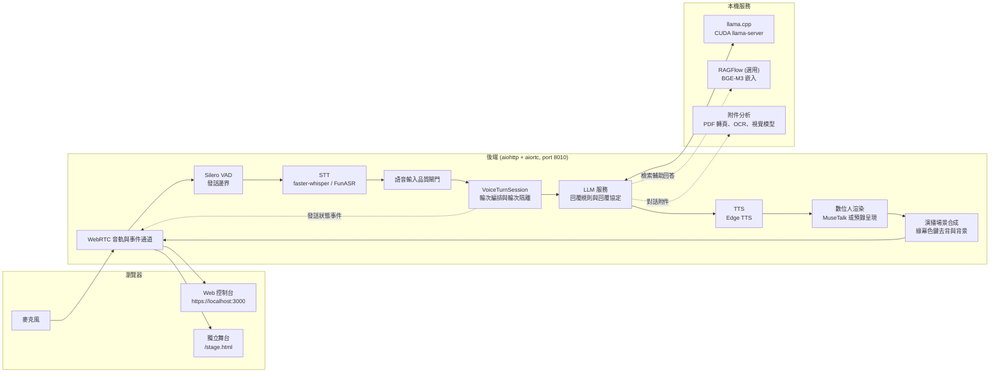
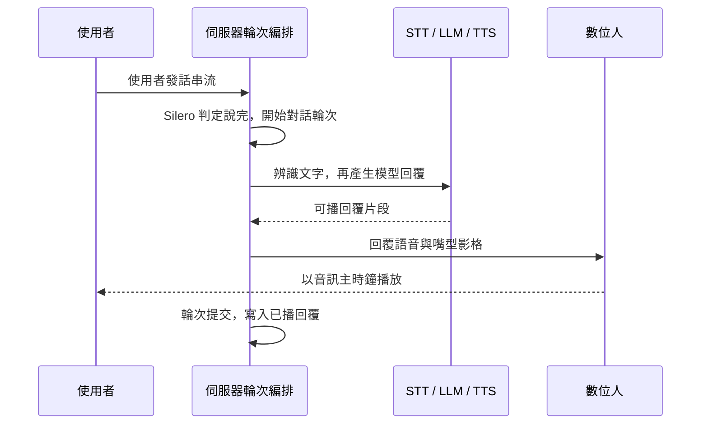

<!--
Copyright (c) 2026 HongXian0903
SPDX-License-Identifier: Apache-2.0
-->

# Nova Avatar 系統架構（Jetson AGX Orin 版）

本文說明 `jetson-orin` 分支的整體架構、一段對話如何流過各個元件，以及原始碼的對應位置。
用語以 [CONTEXT.md](../CONTEXT.md) 的定義為準，各項設計決定的理由見 [ADR](adr/)。

## 一句話概述

瀏覽器透過 WebRTC 把麥克風音訊送到後端；後端依序完成語音端點偵測、語音轉文字、
模型回答、語音合成與數位人渲染，再把影音、字幕和看板送回瀏覽器。
**整個對話輪次由伺服器單獨編排**（[ADR-0003](adr/0003-server-owned-conversation-turns.md)），
前端只負責收音、播放和顯示。

## 資料流

重點：

1. **使用者發話串流**：免按對話可收音期間，瀏覽器持續送出麥克風音軌，
   由伺服器上的 Silero 判定發話邊界（[ADR-0002](adr/0002-server-side-streaming-silero-vad.md)）。
2. **語音輸入品質閘門**：依有效發話時長、音量與可用信心分數，丟棄無效音訊或不可靠的轉寫；
   被丟棄的輸入不建立使用者訊息、不呼叫模型、也不寫入對話歷史。
3. **發話狀態事件**：數位人開始或停止輸出回覆語音時，由伺服器主動推送，
   作為**收音暫停**與恢復的依據（[ADR-0001](adr/0001-push-avatar-speaking-state-over-webrtc.md)）。
4. 預設不持久保存原始麥克風音訊（[ADR-0004](adr/0004-do-not-retain-microphone-audio-by-default.md)）。

## 對話輪次的生命週期

- **同一時間只有一個輪次**。使用者按下麥克風可**插話**，先結束目前回覆再開始新發話。
- **輪次隔離**：取消確認後，尚未播放的舊輪次資料在每個輸出邊界都被丟棄，不產生殘留雜音。
- **音訊主時鐘**：以回覆音訊時間軸作為數位人播放進度的權威。
  嘴型推理落後時可以丟幀或短暫重複，但不拖慢語音（[ADR-0007](adr/0007-stream-replies-with-turn-isolation-and-audio-clock.md)）。
- **輪次提交**：輪次結束時，才把使用者發話與**已播回覆**寫入對話歷史，
  作為控制台靜態紀錄的唯一依據（[ADR-0010](adr/0010-console-rest-state-follows-turn-commit.md)）。

### 兩種回覆方式

| 方式 | 行為 | 出廠預設 |
| --- | --- | --- |
| 舊有回覆模式 | 模型先產生完整回覆，再交付語音與播放 | 是（`reply_streaming.enabled: false`） |
| 回覆語音串流 | 模型尚未寫完時，已形成**完整語意邊界**的**可播回覆片段**就持續交給語音合成 | 否，可在控制台開啟 |

兩者共用相同的字幕、播放與錯誤恢復保證。回覆語音串流以回覆背壓控制延遲預算：
待合成或待播放內容滿載時，先讓模型串流等待；持續滿載才在完整語意邊界終止。

### 回答的呈現

同一個 LLM 依**回覆規則**決定直接口述，或「口語摘要＋看板回覆」。模型輸出的
**回覆協定**（模式標記與看板 JSON）由後端解析，語音、字幕與對話歷史只使用口語文字，
看板項目另行顯示。詳見 [對話模型、角色與回覆規則](llm-reply-rules.md)。

## 數位人呈現

| 呈現方式 | 說明 | 文件 |
| --- | --- | --- |
| MuseTalk 即時嘴型 | 以音訊即時生成嘴型影格；Jetson 上使用 TensorRT UNet 與 TAESD 輕量解碼；段落邊界以嘴型連續控制與回答收尾穩定處理 | [即時生成測試](realtime-avatar.md) |
| 預錄呈現 | 以預錄的待機影片與說話影片呈現，回覆語音仍由當輪回答產生，不逐字對嘴 | [預錄數位人](prerecorded-avatars.md) |

兩者共用同一套對話、語音與舞台流程，只改變畫面的來源。每位角色分別保存呈現方式。

MuseTalk 綠幕角色可在伺服器端做**綠幕色鍵去背**，再放到共用的**舞台背景**，
講話中也能切換背景（[ADR-0014](adr/0014-compose-green-screen-avatars-on-server.md)）。
控制台預覽與獨立舞台共同呈現同一個**演播場景**。

## 選用功能

| 功能 | 說明 | 文件 |
| --- | --- | --- |
| 知識庫檢索 | 獨立部署的 RAGFlow 只提供檢索片段，由 Nova 的 LLM 總結成回答（[ADR-0013](adr/0013-use-ragflow-for-retrieval-only.md)） | [ragflow.md](ragflow.md) |
| 對話附件 | 使用者可在一場對話附上 PDF 或圖片供分析與追問，本機 OCR，不自動成為永久知識庫（[ADR-0018](adr/0018-session-owned-conversation-attachments.md)） | [conversation-attachments.md](conversation-attachments.md) |
| 舞台語系 | 每場舞台對話各自選擇繁體中文或 English，涵蓋介面、辨識、回覆與聲音（[ADR-0017](adr/0017-session-owned-stage-language.md)） | [CONTEXT.md](../CONTEXT.md) |
| 固定朗讀 | 不載入 LLM、VAD、ASR，專用於流暢度與口型驗證 | [fixed-read-aloud.md](fixed-read-aloud.md) |

## 原始碼對照

| 路徑 | 職責 |
| --- | --- |
| `src/server/` | aiohttp 服務、`voice_session.py`（一場 WebRTC 麥克風會話與輪次）、`routes/`（WebRTC、聊天、設定、附件、預錄、RAGFlow、語音驗證、健康檢查） |
| `src/server/reply_streaming/` | 回覆語音串流：片段切分、有界通道、媒體債務、重試、輪次與電路斷路器 |
| `src/vad/` | Silero 串流端點偵測與切句 |
| `src/asr/` | 語音轉文字引擎：`whisper.py`（faster-whisper）、`funasr.py` |
| `src/llm/` | LLM 服務、llama.cpp 啟動與預熱、回覆規則、回覆協定解析、看板分流、歷史與 Context 用量 |
| `src/tts/` | TTS 引擎工廠；`edge_connection.py` 維持可重用的 Edge 連線 |
| `src/avatars/` | 數位人引擎工廠與目錄；`musetalk/`（含嘴型連續控制、TAESD 與 TensorRT 加速）、`prerecorded.py`、`presentation.py` |
| `src/scene/` | 共用舞台背景，在數位人渲染執行緒之外解碼 |
| `src/ragflow/` | RAGFlow 檢索用戶端與逐角色的非機密設定 |
| `src/config/` | 設定載入、出廠預設與執行期覆蓋設定 |
| `web/` | Vue 3 + Vite 控制台與 `stage.html` 舞台；`src/composables/useWebRTC.js` 負責連線 |
| `config/` | `config_jetson*.yaml` 出廠預設設定與 RAGFlow 設定範本 |
| `scripts/` | Jetson 建置、啟動、驗證與 RAGFlow 管理腳本 |

## 設定的層次

1. **出廠預設設定**：`config/config_jetson.yaml`（一般）、`config_jetson_read_aloud.yaml`、
   `config_jetson_realtime.yaml`。
2. **執行期覆蓋設定**：控制台保存到 `config/runtime_overrides.yaml`，啟動時覆蓋
   `llm`、`model`、`video`、`reply_streaming`、`vad`、`asr`、`tts`。
   `--read-aloud` 與 `--realtime` 會忽略它（`NOVA_AVATAR_RUNTIME_OVERRIDES_ENABLED=0`）。

模型的完整清單見 [models.md](models.md)。

## 服務與連接埠

| 服務 | 位址 | 說明 |
| --- | --- | --- |
| 前端 | `https://localhost:3000` | 控制台；`/stage.html` 為舞台 |
| 後端 | `https://localhost:8010` | WebRTC 信令、API、`/health` |
| llama.cpp | `http://127.0.0.1:8080/v1` | 由後端以 `Popen` 啟動並持有（**Owned llama-server**），正常關閉時一併停止 |
| RAGFlow | `http://127.0.0.1:8088` | 選用，僅本機 loopback |

HTTPS 是瀏覽器取得麥克風權限所需，憑證由 `scripts/create_ssl_certs.sh` 產生。

## Jetson 資源邊界

- AGX Orin 的 CPU 與 GPU 共用記憶體；系統、WebRTC 媒體排程、解碼與推論共用同一批 CPU。
  `scripts/start-jetson.sh` 預設把 OpenMP／OpenBLAS／MKL／OpenCV 執行緒限制為 1
  （可用 `NOVA_AVATAR_CPU_THREADS` 調整），避免小型運算爭用 CPU。
- Orin 的 `nvidia-smi` 無法回報可用顯存，llama.cpp 的 GPU 層數規劃以
  `torch.cuda.mem_get_info()` 作為 fallback。
- 影音解碼、WebRTC 傳輸與部分音訊前處理仍使用 CPU。
- 已知限制見 [Orin 建置與 CUDA 驗證](jetson-orin.md#本機驗證結果2026-09-30)：
  短測試的首音延遲未達原有 2.5 秒目標，1080×1920 背景合成也超過原有 30 ms 影格預算。
